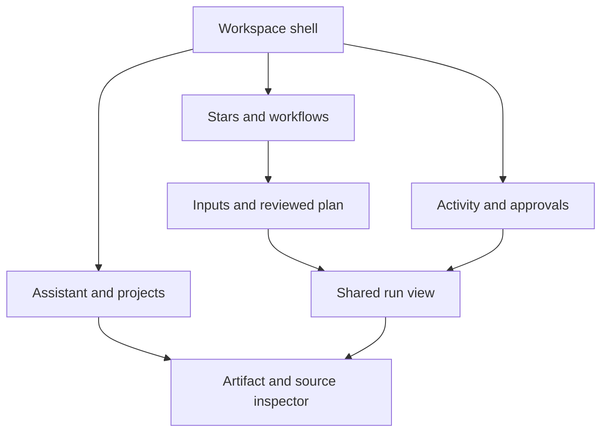

# Screen contracts and implementation checklist

All routes below are proposed app navigation. They do not rename or delete existing routes. Each checklist remains open until implementation and runtime evidence exist.

## Navigation and responsive behavior

Desktop: 224px rail (Assistant, Projects, Stars, Workflows, Activity), workspace switcher above, usage/settings below. Main region contains the current artifact or conversation. Inspector is 320px and user-controlled. Approval count appears in Activity; new approvals are also attached to their run. Search/command uses Ctrl/Cmd+K.

Tablet: 72px rail with accessible labels and tooltips; optional expanded drawer; inspector overlays and returns focus to its trigger. At 768px the main region is never squeezed beside a persistent inspector. Phone: four bottom destinations (Home, Projects, Activity, More), persistent labeled capture action and full-screen inspector routes. Stars/Workflows live in More and outcome shortcuts, not two more bottom tabs. Bottom inset includes safe area; keyboard opening keeps composer visible and hides only nonessential navigation.

Extension: compact header with workspace and availability; Capture / Ask / Run tabs. No duplicate full workspace sidebar. Sources and full-scope approvals can open a full page when the sidepanel cannot display authoritative detail.

Proposed deep links: `/app/:workspace/assistant`, `/app/:workspace/projects/:project`, `/app/:workspace/stars/:star`, `/app/:workspace/workflows/:workflow`, `/app/:workspace/runs/:run`, `/app/:workspace/sources/:source`, `/app/:workspace/approvals/:approval`, `/app/:workspace/settings/usage`. Resolver must validate workspace and object access before rendering; notification/link contents grant no authority.

Reference widths: 1440 desktop, 768 tablet, 390 phone, 360 extension; release also requires 375 and 320 reflow. Portrait/landscape, split-screen, long translations and 200% text zoom may select a narrower layout. Use container width, not device detection.

## S01 · Create a workspace

Job: Start one useful project with explicit context boundaries. Primary action: **Create workspace**. Surfaces: desktop, tablet, mobile.

Structure: Workspace name → First outcome → Private by default → Optional invite later → Sample mission.

Existing: No verified account-backed workspace creation. /platform is a portable editor; sign-in setup is pending in the inspected live state.

Mapping: Existing TextField, Toggle, EmptyState; new WorkspaceCreate view and host adapter.

States: Loading: hold name and intent. Empty: try sample without account. Error: inline name/server error; preserve inputs. Approval: invitations and connectors are separate explicit actions.

- [ ] Implement the structure using existing owned primitives and explicit adapters.
- [ ] Test narrow layout, keyboard/touch, reduced motion, long content and screen-reader names.
- [ ] Submit once, reload accepted workspace, preserve failed input, no implicit connector grant; guest example starts no paid run.
- [ ] Bind preview evidence to exact commit, viewport, scenario and observed outcome.

## S02 · Ask and inspect

Job: Ask a question, choose a route, inspect the resulting work. Primary action: **Send**. Surfaces: desktop, tablet, mobile, extension.

Structure: Project context chip → Requested model route → Assistant stream → Actual model identity → Artifact dock → Sources drawer.

Existing: ChatStream and extension Composer exist. /platform has a model-route select for exports; hosted cloud action is disabled in the observed state.

Mapping: ChatStream, ArtifactCard, StatusChip; adapt ModelSelector behind authoritative catalog. New ModelIdentity and DraftComposer acknowledgment.

States: Loading: stable transcript and Stop request. Empty: three outcome examples. Error: preserve unsent draft and partial output. Approval: open exact scope before any external action.

- [ ] Implement the structure using existing owned primitives and explicit adapters.
- [ ] Test narrow layout, keyboard/touch, reduced motion, long content and screen-reader names.
- [ ] IME-safe send, failed-send draft recovery, requested versus actual model labeled, unavailable route explained; never fabricate model/cost.
- [ ] Bind preview evidence to exact commit, viewport, scenario and observed outcome.

## S03 · Choose a Star

Job: Choose the specialist by the result it can produce. Primary action: **Configure Star**. Surfaces: desktop, tablet, mobile.

Structure: Outcome search → Availability filter → Star result card → Inputs and output → Permission summary → Project defaults.

Existing: AgentCard and seven preview crew roles exist. Additional roles are blueprint in the shared roster.

Mapping: Retain AgentCard and AgentAvatar. Extend with typed outcome/input/output/availability. AgentPresence is a candidate companion.

States: Loading: fixed-size cards. Empty: clear filters or use assistant. Error: keep last catalog labeled stale. Approval: configure scope then review plan; discovery never invokes.

- [ ] Implement the structure using existing owned primitives and explicit adapters.
- [ ] Test narrow layout, keyboard/touch, reduced motion, long content and screen-reader names.
- [ ] Stable agentId, repeated cards have unique DOM IDs, unavailable Stars have truthful CTA, configuration survives Back; no personality-based authority.
- [ ] Bind preview evidence to exact commit, viewport, scenario and observed outcome.

## S04 · Prepare a workflow

Job: Turn defined inputs into a bounded plan before execution. Primary action: **Review plan**. Surfaces: desktop, tablet, mobile.

Structure: Outcome card → Required inputs → Expected artifact → Source scope → Budget cap → Review plan.

Existing: Live /missions has brief inputs and a plan step for a public Node repository; no generalized workflow catalog was established.

Mapping: Reuse mission brief validation, TextField and EvidenceDisclosure. New WorkflowCard composition with authoritative input schema and permissions.

States: Loading: preserve form. Empty: apply labeled sample input. Error: map errors to fields. Approval: review action/input revisions, scope and cap before Run.

- [ ] Implement the structure using existing owned primitives and explicit adapters.
- [ ] Test narrow layout, keyboard/touch, reduced motion, long content and screen-reader names.
- [ ] Schema validates on client and server, no execution on card selection or model change, unsupported connector identified before run.
- [ ] Bind preview evidence to exact commit, viewport, scenario and observed outcome.

## S05 · Follow a run

Job: See progress, inspect output, and handle uncertainty without losing work. Primary action: **Open artifact**. Surfaces: desktop, tablet, mobile, extension.

Structure: Run status → Step timeline → Actual models → Sources → Artifacts → Stop request.

Existing: Shared reducer, RunGraph, ChatStream and ArtifactCard exist. PR97 Command Center is a bounded local simulation.

Mapping: Use existing run reducer and cards. Project timeline from same state; add protocol-backed stopped/unknown states before UI exposure.

States: Loading: queued/running text with last event time. Empty: no artifacts yet. Error: distinguish stream disconnected from run failed. Approval: waiting-for-review is separate from running.

- [ ] Implement the structure using existing owned primitives and explicit adapters.
- [ ] Test narrow layout, keyboard/touch, reduced motion, long content and screen-reader names.
- [ ] Reconnect resumes by sequence; duplicate events do not duplicate effects; stopping stays pending until server confirms; artifacts stay readable after failure.
- [ ] Bind preview evidence to exact commit, viewport, scenario and observed outcome.

## S06 · Inspect research

Job: Check a claim against the exact source and keep its limits visible. Primary action: **Open original**. Surfaces: desktop, tablet, mobile, extension.

Structure: Readable artifact → Inline claim anchors → Source list → Excerpt and locator → Retrieved timestamp → Source access state.

Existing: Artifacts expose provenance and hashes; ToolResult.sources is URL[] only. Claim-to-locator evidence requires a new shared projection.

Mapping: ArtifactCard plus EvidenceDisclosure; new SourceAnchor, SourceInspector and ClaimSupportView.

States: Loading: keep claim in place. Empty: no source supplied. Error: denied/removed/stale source with original locator retained. Approval: new source access needs separate grant.

- [ ] Implement the structure using existing owned primitives and explicit adapters.
- [ ] Test narrow layout, keyboard/touch, reduced motion, long content and screen-reader names.
- [ ] Citations focus matching source; Back restores reading position; unsupported claim says source missing; retrieved date is not publication date.
- [ ] Bind preview evidence to exact commit, viewport, scenario and observed outcome.

## S07 · Project knowledge and memory

Job: Carry useful context forward while controlling who may retrieve it. Primary action: **Save permission change**. Surfaces: desktop, tablet, mobile.

Structure: Project files → Memory entries → Retrieval scope → Contributors → Usage provenance → Export and remove.

Existing: /platform has context/soul/starlight/memory/evidence files, opt-in local recovery, import/export. Live text says recovery is unencrypted and not account synced.

Mapping: Retain portable editor/import/export. Tabs, DataTable, EvidenceDisclosure, Toggle; new access-policy adapter.

States: Loading: do not replace editor text. Empty: add a file or sample. Error: save conflict retains both revisions. Approval: distinguish personal/project/team scope and future retrieval revocation.

- [ ] Implement the structure using existing owned primitives and explicit adapters.
- [ ] Test narrow layout, keyboard/touch, reduced motion, long content and screen-reader names.
- [ ] Cloud save only after acknowledgment; tab/device/account states differ; scope change enforced server-side; removal explains future retrieval versus historical run copies.
- [ ] Bind preview evidence to exact commit, viewport, scenario and observed outcome.

## S08 · Usage and subscription

Job: Understand metered use and a plan change before committing. Primary action: **Review plan change**. Surfaces: desktop, tablet, mobile.

Structure: Current entitlement → Billing period → Included and reserved use → Unknown measurements → Plan comparison → Change summary.

Existing: PR97 UsageDisplay honestly handles unknown values; PricingCard is one-time pricing and CheckoutSummary is a local order specimen. No live subscription flow established.

Mapping: Reuse UsageDisplay behavior. New SubscriptionPlan and BillingChange view models; do not adapt one-time card copy by hiding labels.

States: Loading: retain last measured timestamp. Empty: no billable usage. Error: unavailable billing/entitlement state. Approval: effective date, currency, tax and total from server preview before commit.

- [ ] Implement the structure using existing owned primitives and explicit adapters.
- [ ] Test narrow layout, keyboard/touch, reduced motion, long content and screen-reader names.
- [ ] No invented price, reset date or free allowance; amount/currency/period explicit; denied quota preserves work; pending payment is not entitlement.
- [ ] Bind preview evidence to exact commit, viewport, scenario and observed outcome.

## S09 · Capture from the browser

Job: Save only the selected page material into the intended project. Primary action: **Save selection**. Surfaces: extension, desktop, tablet, mobile.

Structure: Origin and page title → Selection preview → Capture scope → Project destination → Save state → Open in workspace.

Existing: Extension sidepanel App/PageAccess and capture-visible, read-active-tab, send-to-mission tools exist in source; installed release not verified.

Mapping: Reuse page-access guard, selected-text prefill and ArtifactCard. New capture acknowledgment and deduplication adapter.

States: Loading: one pending save. Empty: select text or use chosen page. Error: access denied/offline queue labeled. Approval: explicit page/selection scope; no background tab access.

- [ ] Implement the structure using existing owned primitives and explicit adapters.
- [ ] Test narrow layout, keyboard/touch, reduced motion, long content and screen-reader names.
- [ ] Preview exact payload and destination; credentials/query secrets excluded; save success requires receipt; retry same captureId avoids duplicate; queued differs from saved.
- [ ] Bind preview evidence to exact commit, viewport, scenario and observed outcome.

## S10 · Capture an idea by voice

Job: Keep an idea quickly, then decide when its text may leave the device. Primary action: **Save capture**. Surfaces: mobile.

Structure: Recording control → Elapsed time → Pause and stop → Transcript editor → Destination → Local/queued/saved status.

Existing: Native mobile is absent from the inspected CLIENT_SURFACES list (extension and desktop only). This is a concept, not an implemented Starlight mobile screen.

Mapping: New native recorder/share adapter; reuse token roles, CaptureView contract and destination language. No native stack choice made here.

States: Loading: processing with audio retained until policy says otherwise. Empty: tap to record or type. Error: permission denial offers text; offline preserves local draft. Approval: disclose off-device transcription before sending.

- [ ] Implement the structure using existing owned primitives and explicit adapters.
- [ ] Test narrow layout, keyboard/touch, reduced motion, long content and screen-reader names.
- [ ] One-handed 48dp controls, stop recording on interruption, permission denied recovery, encrypted local queue and explicit sync acknowledgment; no automatic run.
- [ ] Bind preview evidence to exact commit, viewport, scenario and observed outcome.

## S11 · Review an agent action

Job: Approve the exact action with enough context to accept responsibility. Primary action: **Approve exact action**. Surfaces: desktop, tablet, mobile, extension.

Structure: Actor and project → Action and full scope → Destination and data → Revision and expiry → Budget impact → Approve / Decline.

Existing: Web ApprovalCard binds artifacts and shows replay resolution. Shared RunApproval only has pending/approved/rejected; expiry/revision binding not established in projection.

Mapping: Retain authoritative ApprovalCard; new pending-submission/stale/expired/unknown adapter after protocol support. Extension platform decisions may require console.

States: Loading: buttons disabled while full scope loads. Empty: no decisions waiting. Error: submission outcome unknown; inspect same approval before retry. Approval: changed/expired requests cannot be accepted.

- [ ] Implement the structure using existing owned primitives and explicit adapters.
- [ ] Test narrow layout, keyboard/touch, reduced motion, long content and screen-reader names.
- [ ] Server binds actor, tenant, run, scope hash, revision and expiry; no swipe/notification approval; offline read only; retry idempotent; decision receipt separate from execution result.
- [ ] Bind preview evidence to exact commit, viewport, scenario and observed outcome.

## Sequenced delivery and acceptance owner

| Slice | Owner | Screen contracts | Exit evidence |
| --- | --- | --- | --- |
| 1 · Complete one outcome | Web/extension integrator | S02, S04, S05, S06, S09, S11 | capture receipt → project context → bounded run → artifact/source → exact approval; draft survives failure |
| 2 · Persistence and discovery | Web + shared services | S01, S03, S07 | create/reload/access denial, permission changes and repeat project outcome |
| 3 · Commercial controls | Billing engineer + owner | S08 | sandbox purchase/entitlement, accurate usage, quota recovery, cancellation; owner-approved terms/prices |
| 4 · Native surfaces | Mobile integrator | S10 and S11 | capture interruption/offline queue, safe deep link, server-bound approval on real devices |

The UI integrator owns consistency, the protocol owner owns authority/state semantics, and the owner approves design/release. No mobile renderer or framework is selected here because the source audit and estate registry are incomplete.
